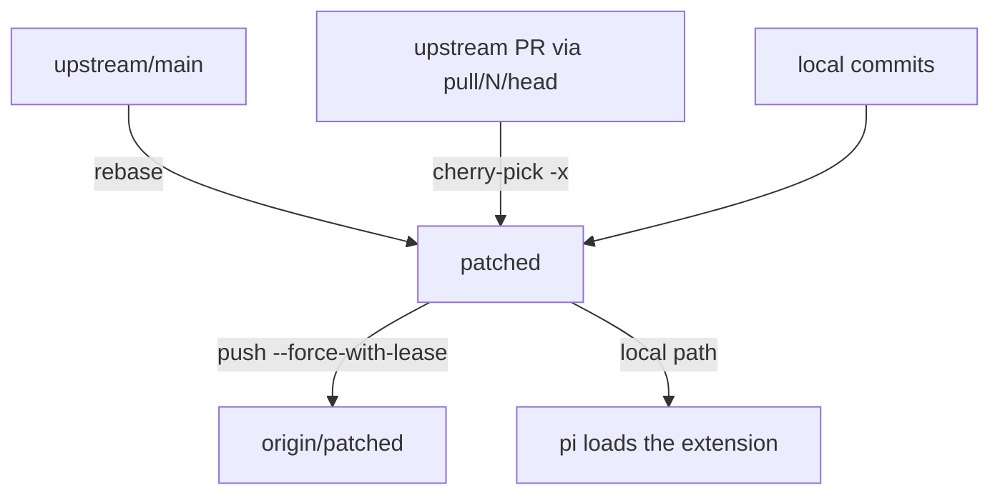

# Patched branch

This worktree holds the `patched` branch: `upstream/main` plus selected open
upstream PRs and local fixes. pi loads the extension directly from this
directory instead of the upstream package.

- Worktree: `~/Development/mrclrchtr/pi-claude-code-patched`
- Branch: `patched` (pushed to `origin/patched`)
- Base: always `upstream/main` (`earendil-works/pi-claude-code`)



## Applied changes

| Source | Commit subject | Status |
| --- | --- | --- |
| upstream PR #73 | fix: disable Claude Code's silent turn reminder in workers | open upstream |
| upstream PR #39 | fix: answer orphaned tool calls before replay | open upstream |
| upstream PR #41 | fix: cap request-wide cache breakpoints at four | open upstream |
| upstream PR #47 | fix: keep Pi's own image scale note when rebuilding user messages | open upstream |
| upstream PR #55 | fix: drop blank user text that Claude Code removes from its request | open upstream |
| upstream PR #69 | fix: default the output budget to the model's maxTokens | open upstream |
| upstream PR #26 | fix(relay): give each upstream address at least 5 s to connect | open upstream |
| upstream PR #58 | fix: send failed tool results as text so they line up with Claude Code's copy | open upstream |
| upstream PR #68 | fix: accept the images the CLI removes to fit its media limits (2 commits) | open upstream |
| upstream PR #32 | fix: accept a string-content first user message in rewriteInitialRequest | open upstream |
| upstream PR #57 | fix(replay): omit historical output config on fallback (2 commits) | open upstream |
| upstream PR #56 | fix: report a server error event in a 200 stream as retryable | open upstream |
| upstream PR #51 | fix: tag replayed assistant turns with their model (2 commits) | open upstream |

Update this table when you add or drop a change.

Before adding an upstream PR, review its diff for security (dependencies,
network targets, process spawning, file and env access, hidden Unicode) and
cherry-pick the reviewed head commit, not a moving branch.

## Add an upstream PR

```bash
git fetch upstream pull/<N>/head:pr-<N>
git cherry-pick -x upstream/main..pr-<N>
```

`-x` records the source commit in the message. Resolve conflicts, then run
`git cherry-pick --continue`.

## Add a local change

Commit directly on `patched`. Keep each fix in its own commit so it can be
dropped or turned into an upstream PR later.

## Update to the latest upstream

```bash
git fetch upstream
git rebase upstream/main
```

Commits already merged upstream drop out automatically. If a PR was merged
in a modified form, the rebase may conflict; skip the commit with
`git rebase --skip` and remove it from the table.

## Verify and publish

```bash
npm ci
npm run check
mise exec node@24 -- npm test
git push --force-with-lease origin patched
```

The test script needs Node 24: Node 26 removed `--experimental-transform-types`,
and strip-only mode rejects the TypeScript parameter properties used in `src/`.

## Activate in pi

pi loads this directory directly, so restart pi (or run `/reload`) after any
change. No reinstall is needed.

Initial setup and rollback:

```bash
# use the worktree
pi remove https://github.com/earendil-works/pi-claude-code
pi install ~/Development/mrclrchtr/pi-claude-code-patched

# back to upstream
pi remove ~/Development/mrclrchtr/pi-claude-code-patched
pi install https://github.com/earendil-works/pi-claude-code
```

## Notes

- Do not check out `patched` in the main checkout while this worktree uses it.
- Run git commands for this branch inside this worktree.
